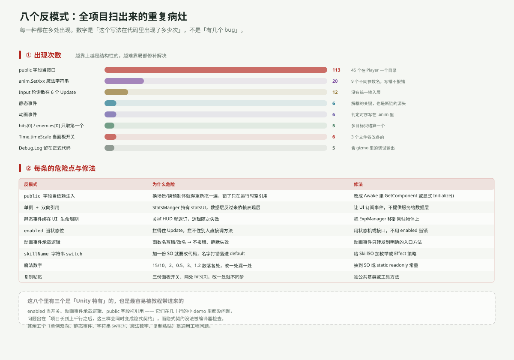

---
title: ARPG 代码分析（三）：八个反模式
date: 2026-11-06 21:20:00
tags: Unity, ARPG, 代码审查, 反模式, 架构
summary: 把 31 个文件里反复出现的写法归成八类：public 字段当依赖注入（113 次）、anim.SetXxx 魔法字符串（20 次）、Input 轮询散在 6 个 Update、6 组静态事件、6 个动画事件、hits[0] 只取第一个（5 次）、Time.timeScale 当面板开关、Debug.Log 留在正式代码。每条都给出出现位置、为什么危险、以及不用大改就能收敛的修法。
cover: images/arpg-code-c9.svg
pinned: false
draft: false
slug: arpg-code-antipatterns
---

## 一句话说清

这八个不是八个 bug，是**八种会不断复发的写法**。每修一个 bug，如果不改写法，下次还会长出新的。

其中三个是 Unity 特有的（`enabled` 当开关、动画事件承载逻辑、public 字段拖引用），也是最容易被教程带进来的。

---

## 出现次数



| 反模式 | 次数 | 最集中的地方 |
|---|---|---|
| public 字段当接口 | 113 | `Player` 一个目录 45 个 |
| `anim.SetXxx` 魔法字符串 | 20 | 9 个不同参数名 |
| Input 轮询散在多个 `Update` | 12 | 6 个文件 |
| 静态事件 | 6 | 5 个文件 |
| 动画事件 | 6 | 近战 2 / 远程 5 剪辑共用 / 敌人 3 |
| `hits[0]` 只取第一个 | 5 | 战斗 2 处 + 拾取 |
| `Time.timeScale` 当开关 | 6 | 3 个文件 |
| `Debug.Log` 留在正式代码 | 5 | 含 gizmo 里的调试输出 |

---

## ① public 字段当依赖注入（113 次）

```csharp
public Player_Combat player_Combat;   // PlayerMovement 里
public InventoryManager inventoryManager;   // ShopManager 里
public StatsUI statsUI;   // StatsManger 里
```

**为什么危险**：这些字段的值不在代码里，在场景文件里。所以：

- 换场景 / 换预制体 → 全部重新拖一遍
- 漏拖一个 → 运行时 `NullReferenceException`，编译期完全看不出来
- 代码读起来「这个字段从哪来的」无法回答

**修法**（按成本递增）：
1. 同一物体上的引用 → `Awake()` 里 `GetComponent<T>()`（`Enemy` 模块已经是这么做的）
2. 跨物体的引用 → 提供 `Initialize(T dep)`，由上层显式传
3. 真需要全局的 → 单例或事件，而不是拖

`Enemy` 模块和 `Player` 模块正好是两个极端：前者 237 行只有 7 处 `GetComponent`、15 个 public 字段；后者 462 行 45 个 public 字段。**同一个项目里有两套接线习惯**，这是最该先统一的。

---

## ② 单例 + 双向引用

```csharp
// StatsManger（数据层）
public StatsUI statsUI;

public void UpdateSpeed(int amount)
{
    speed += amount;
    statsUI.UpdateAllStats();   // ← 数据层反过来命令表现层
}
```

**为什么危险**：数据层本该不知道 UI 存在。现在它俩互相持有——`StatsUI` 读 `StatsManger.Instance`，`StatsManger` 又持有 `statsUI`。

于是「谁负责刷新面板」这件事没有唯一答案：`Start()` 刷一次、`UpdateSpeed` 刷一次、`UpdateHealth` 不刷。**同一个类里三个方法，三种命运。**

**修法**：`StatsManger` 改发事件（`OnStatsChanged`），`StatsUI` 订阅。数据层从此不认识 UI。

---

## ③ 静态事件裸调用 + 订阅绑在 UI 生命周期上

```csharp
// 发布方：Enemy_Health
OnMonsterDefeated(expReward);       // 没有 ?.

// 订阅方：ExpManager（挂在 ExpCanvas 上）
private void OnEnable()  { Enemy_Health.OnMonsterDefeated += GainExperience; }
private void OnDisable() { Enemy_Health.OnMonsterDefeated -= GainExperience; }
```

两件事叠在一起才是灾难：

- 裸调用 → 没有订阅者就抛异常 → `Destroy` 不执行
- 订阅写在 `OnEnable/OnDisable`，而宿主是 UI 物体 → **关掉 HUD 就等于退订**

合起来：`ExpCanvas.SetActive(false)` → 事件没人听 → 敌人打不死。

**修法**：`?.Invoke` 是必要条件，不是充分条件。真正的修法是把 `ExpManager` 挪到常驻物体上，让它不随 UI 消亡。

---

## ④ enabled 当状态位

```csharp
// Player_ChangeEqiupment
combat.enabled = !combat.enabled;
bow.enabled = !bow.enabled;
```

**为什么危险**：`enabled = false` 只做一件事——**让 Unity 不再调这个组件的 `Update` / `OnEnable` 等回调**。它做不到：

- 阻止别人直接调 `player_Combat.Attack()`
- 停掉已经启动的协程
- 让组件「不存在」

实际后果：`Player_Combat.Update()` 里的冷却计时会停，切回来时 `timer` 还是旧值；而 `Attack()` 照样能被外部调用。

**修法**：用状态机（`WeaponState { Sword, Bow }`）或接口，而不是翻 `enabled`。

---

## ⑤ 动画事件承载逻辑

全项目 6 个动画事件：

| 文件 | 时间 | 函数 | 干了什么 |
|---|---|---|---|
| `Slash.anim` | 0.27 | `DealDamage` | 真正扣血 |
| `Slash.anim` | 0.42 | `FinishAttacking` | 解除动画状态 |
| `Attack_Right.anim` | 0.30 | `Attack` | `Enemy_Combat.Attack()`（+ 一个空转的同名方法） |
| `Attack_Right.anim` | 0.59 | `ChangeState` ×2 | 把状态改回 Idle |
| `Archer_Shoot_*.anim` | 出箭帧 | `Shoot` | `Instantiate` 箭 |

**为什么危险**：这份逻辑**不在任何 `.cs` 文件里**。

- 改函数名 → 动画事件静默失效（不报错）
- 只看代码 → 会以为 `Attack()` 一调就掉血
- 换动画 → 手感跟着变，但没人知道为什么

**修法**：动画事件只调一个**命名明确的入口**（`OnAnimationHitFrame()`），入口里再分派；或者干脆用 `AnimationClip.length` 做计时。至少要有注释说明「这个时序在 .anim 里」。

---

## ⑥ 靠字符串匹配

```csharp
// SkillManager
switch (skillName)
{
    case "Max Health Boost": StatsManger.Instance.UpdateMaxHealth(1); break;
    case "Sword Slash":      combat.enabled = true;                  break;
    default: Debug.LogWarning("Error" + skillName);                  break;
}
```

**为什么危险**：`skillName` 是 `SkillSO` 上的一个字符串字段（人可以随便改）。打错一个字，就落进 `default`，只打一行 `LogWarning`——技能「点了没反应」。

现状：24 个格子挂了 4 份 SO，其中 `2Boost` / `3Boost` 压根不在 `switch` 里，点满只是刷 `LogWarning`。

**修法**：给 `SkillSO` 加枚举或 `SkillEffect` 基类（`MaxHealthEffect`、`Enemy`…），用 `ScriptableObject` 装行为而不是装名字。

---

## ⑦ 魔法数字

| 数字 | 位置 | 含义 |
|---|---|---|
| `15` / `10` | `Elevation_Entry/Exit` | 玩家的排序号（进出山洞） |
| `2` | `Player_Combat` / `Enemy_Movement` | 攻击冷却 |
| `0.5` | `Player_Bow` | 出箭间隔 |
| `3` | `ItemSo` | 默认堆叠上限 |
| `10` / `1.2` | `ExpManager` | 经验门槛与增长 |
| `1` | `ExpManager.LevelUp` | 每级给的技能点（硬编码） |

最危险的是 `15` / `10`：`10` 隐含了「玩家的默认排序号就是 10」这个从未写下来的假设。玩家默认排序一变，走出山洞就钻到山后面去了——**不报错，只是「看起来怪」**。

**修法**：`Entry` 里先存 `originalOrder = sr.sortingOrder`，`Exit` 还原；其余数字搬进 SO 或 `static readonly`。

---

## ⑧ 复制粘贴

**三份面板开关**（`StatsUI` / `ToggleSkillTree` / `ShopKeeper`）几乎逐字相同：

```csharp
Time.timeScale = 0;
canvasGroup.alpha = 1;
canvasGroup.blocksRaycasts = true;
```

差异只有一处：`ShopKeeper` 还设了 `interactable`，另两个没设。**这就是复制粘贴最典型的症状：三份里有两份少了同一行，而且谁也不知道哪份是对的。**

**两处 `hits[0]`**（`Player_Combat` / `Enemy_Combat`）也是同源代码：都只结算数组第一个元素。

**修法**：抽 `PanelManager`（栈 + 引用计数）和一个 `DealDamageInRadius()` 工具方法。

---

## 三个 Unity 特有的，值得单独警惕

| 反模式 | 为什么在 Unity 里特别隐蔽 |
|---|---|
| `enabled` 当开关 | 它的名字听起来像「启用/禁用」，实际只管回调调用 |
| 动画事件承载逻辑 | 逻辑存在 `.anim` 资产里，代码搜索搜不到 |
| public 字段拖引用 | 值存在场景文件里，`git diff` 看不到，只有打开编辑器才知道 |

它们的共同点：**隐式契约，编译器检查不到。** 在几十行的 demo 里都没问题；项目长到上千行后，这三样会同时变成「只有原作者知道怎么连」的知识。

---

## 一句话总结

八条里，第 ①③④⑤ 条是这次必须面对的（它们直接导致 P0）；第 ②⑥⑦⑧ 条可以排期。

判据只有一个：**这段逻辑，能不能只读 `.cs` 文件就完整地看懂？** 只要答案里有「要看场景」「要看动画」「要记得先拖」，那就是一条债。

下一篇：[如果重写——目录重组与六步迁移](arpg-code-refactor.html)。
