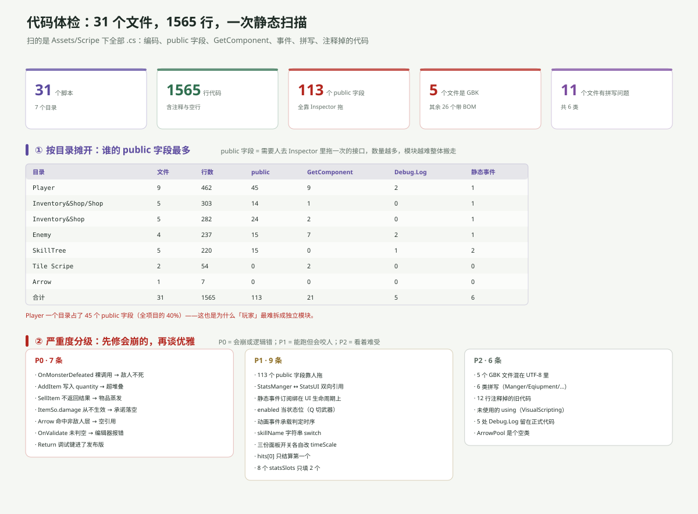

---
title: ARPG 代码分析（一）：31 个文件的一次静态体检
date: 2026-11-06 20:00:00
tags: Unity, ARPG, 代码审查, 重构, C#
summary: 对 Assets/Scripe 下 31 个 .cs 做一次静态扫描：1565 行、113 个 public 字段、21 处 GetComponent、5 处 Debug.Log、6 组静态事件、12 行注释掉的旧代码，另外有 5 个文件是 GBK 编码、11 个文件有 6 类拼写问题。按 P0（会崩或逻辑错）/ P1（能跑但咬人）/ P2（看着难受）分级，每条都带文件和行号。
cover: images/arpg-code-c7.svg
pinned: false
draft: false
slug: arpg-code-audit
---

## 一句话说清

31 个文件里，**真正会导致「玩起来不对」的只有 7 处**（P0），剩下全是「能跑，但下次改会踩」的债。

先修 P0，再谈目录和命名。

---

## 怎么扫的

不是通读，是脚本扫。对 `Assets/Scripe/**/*.cs` 逐个做：

- **编码探测**：先试 UTF-8 BOM → UTF-8 → GBK
- **计数**：public 字段、`GetComponent`、`Debug.Log`、`static event`、注释掉的代码行
- **拼写**：拿一份可疑词表去比对（`Manger`、`Eqiupment`、`Colldown`…）
- **魔法字符串**：`anim.SetBool("...")`、`CompareTag("...")`、`Play("...")`

局限要说清楚：这是正则级扫描，不是编译器级语义分析。所以下面说的「会崩」是**按代码路径推断**，不是跑出来的。

---

## 五个总指标



| 指标 | 数值 | 含义 |
|---|---|---|
| 文件 / 行数 | 31 / 1565 | 含注释与空行，不是有效代码行 |
| public 字段 | 113 | 每一个都要人去 Inspector 拖一次 |
| GBK 文件 | 5 | 中文注释在 UTF-8 环境下是乱码 |
| 拼写问题 | 6 类 / 11 文件 | 不影响运行，影响「能不能搜到」 |
| 静态事件 | 6 组 | 分布在全项目唯一的事件骨架 |

113 个 public 字段是最能说明问题的数字：**这个工程的接线方式，本质上是「人去 Inspector 里连」，而不是「代码里声明」**。所以它没法整体搬迁——换个场景就得重连一遍。

---

## 按目录摊开

| 目录 | 文件 | 行数 | public | GetComponent |
|---|---|---|---|---|
| `Player` | 9 | 462 | **45** | 9 |
| `Inventory&Shop` | 10 | 585 | 38 | 3 |
| `Enemy` | 4 | 237 | 15 | 7 |
| `SkillTree` | 5 | 220 | 15 | 0 |
| `Tile Scripe` | 2 | 54 | 0 | 2 |
| `Arrow` | 1 | 7 | 0 | 0 |

`Player` 一个目录占了 45 个 public 字段（全项目的 40%），而它只有 462 行。**这就是「玩家最难拆成模块」的量化原因。**

反过来看 `Enemy`：237 行、7 处 `GetComponent`——它几乎不靠拖引用，全靠运行时找组件。两种风格在同一个工程里并存。

---

## P0：七处会「玩起来不对」的地方

### ① 敌人打不死

`Enemy/Enemy_Health.cs:26`

```csharp
if (currentHealth <= 0)
{
    OnMonsterDefeated(expReward);   // ← 裸调用，没有 ?.
    Destroy(gameObject);
}
```

如果这一刻没有订阅者（比如挂着 `ExpManager` 的 `ExpCanvas` 被 `SetActive(false)`），会抛 `NullReferenceException`，**后面的 `Destroy` 永远不执行**。

结果：血量已经 ≤ 0 的敌人还站着、还追人、还打人。

修法一个字符：`OnMonsterDefeated?.Invoke(expReward);`

### ② 背包格子能塞超上限

`Inventory&Shop/InventoryManager.cs:56-58`

```csharp
int amountToAdd = Mathf.Min(itemSo.stackSize, quantity);   // 算出来了
slot.itemSo = itemSo;
slot.quantity = quantity;                                   // ← 却用了 quantity
```

算出了「这次最多能放几个」，赋值时却用了**总数量**。`stackSize = 3` 时，一个空格能塞进 10 个。

顺带：这段 `return` 之后，下面的 `if (quantity > 0) DropLoot(...)` 几乎永远走不到——只有「所有格子都满了」才会溢出。

### ③ 卖东西会把物品吞掉

`Inventory&Shop/InventorySlot.cs:44-45` + `Shop/ShopManager.cs:54`

```csharp
// InventorySlot
activeShop.SellItem(itemSo);
quantity--;              // ← 无条件减

// ShopManager
public void SellItem(ItemSo itemSo)
{
    if (itemSo == null) return;
    foreach (var slot in shopSlots)
        if (slot.itemSo == itemSo) { inventoryManager.gold += slot.price; return; }
}                        // ← 找不到同款时静默返回，不通知调用方
```

`SellItem` 返回 `void`，调用方无法知道成功与否。于是「卖一个这家店不收的东西」= 物品凭空少一个、金币不变。

修法：`SellItem` 改 `bool`，调用方按返回值决定要不要 `quantity--`。

### ④ `ItemSo.damage` 是个假字段

`Inventory&Shop/Shop/ShopInfo.cs:28` 会显示它：

```csharp
if (itemSo.damage > 0) stats.Add("Damage+" + itemSo.damage.ToString());
```

但 `Inventory&Shop/UseItem.cs:7-16` 的 `ApplyItemEffects()` 只处理了 `currentHealth` / `maxHealth` / `speed` / `duration`——**`damage` 从来没被应用过**。

也就是说：商店里挂一个「攻击力 +5」的道具，玩家买下、吃掉，**攻击力一点没变**，只有悬停框上写着 +5。

这条和「升级不加属性」是同一个病的两个症状：`StatsManger.damage` 全项目只有两处读（`Player_Combat` 打伤害、`StatsUI` 显示），**没有任何一处写**。

### ⑤ 箭打到「不是敌人的东西」就崩

`Player/Arrow.cs:38-41`

```csharp
if ((enemyLayer.value & (1 << collision.gameObject.layer)) > 0)
{
    collision.gameObject.GetComponent<Enemy_Health>().ChangeHealth(-damage);
    collision.gameObject.GetComponent<Enemy_Knockback>().Knockback(...);
}
```

只要 Enemy 层上出现一个**没有** `Enemy_Health` 的物体（道具箱、可破坏物、忘了挂脚本的怪），这里就是空引用。

同一个问题在 `Enemy_Combat.cs:28-29` 也存在：`hits[0].GetComponent<PlayerHealth>()` 没有空判断。

### ⑥ `OnValidate` 会在编辑器里反复抛异常

`SkillTree/SkillSlot.cs:21-26`

```csharp
private void OnValidate()
{
    if (skillSO != null && skillLevelText != null) { UpdateUI(); }
}
```

只判了两个，但 `UpdateUI()` 里还用了 `skillIcon.sprite` 和 `skillButton.interactable`。新建一个 `SkillSlot` 还没拖图标时，编辑器每次刷新都会抛 `NullReferenceException`。

`Inventory&Shop/Loot.cs:16-19` 一样：`OnValidate → UpdateAppearance()` 里用了 `sr.sprite`，没判空。

### ⑦ 发布版里按回车能白拿经验

`Player/ExpManager.cs:22-25`

```csharp
private void Update()
{
    if (Input.GetKeyDown(KeyCode.Return)) { GainExperience(2); }
}
```

没有 `#if UNITY_EDITOR`。发布版玩家按住回车就能刷经验，而且 `Time.timeScale = 0` 也拦不住 `Update`——开着暂停面板照样涨。

---

## P1：九处「能跑但咬人」的债

| # | 位置 | 问题 |
|---|---|---|
| 1 | 全项目 | 113 个 public 字段，换场景就要重拖 |
| 2 | `StatsManger` ↔ `StatsUI` | 数据层持有表现层引用，双向依赖 |
| 3 | `ExpManager` 挂在 `ExpCanvas` | 关 HUD 就退订，事件链断 |
| 4 | `Player_ChangeEqiupment` | 用 `enabled` 当状态位，拦不住直接调方法 |
| 5 | 6 个动画事件 | 判定时序写在 `.anim` 里，函数名写错不报错 |
| 6 | `SkillManager` | `switch(skillName)` 字符串匹配，加 SO 就要改代码 |
| 7 | 3 个面板 | 各自改 `Time.timeScale`，没有仲裁者 |
| 8 | `Player_Combat` / `Enemy_Combat` | `hits[0]` 只结算第一个 |
| 9 | `StatsUI` | 8 个 `statsSlots` 只填 2 个 |

---

## P2：六处「看着难受」

- 5 个文件是 **GBK**（`ShopInfo` / `ExpManager` / `ShopSlot` / `SkillManager` / `Enemy_Health`），其余 26 个带 BOM。中文注释在这 5 个文件里跨环境就是乱码。
- 6 类拼写，详见[下一篇](arpg-code-naming.html)。
- 12 行注释掉的旧代码，最典型是 `Enemy_Combat.cs:15-20` 整段 `OnCollisionEnter2D`。
- 未使用的 `using`：`PlayerMovement.cs` 引了 `Unity.VisualScripting`，`Arrow.cs` 引了 `UnityEngine.Experimental.GlobalIllumination`——后者是个几乎没人用的命名空间。
- 5 处 `Debug.Log` 留在正式代码里（含 `Enemy_Knockback` 里打印 `rb.velocity`）。
- `Arrow/ArrowPool.cs` 是个**空类**，7 行、零成员、没人引用。

---

## 一句话总结

这个工程的代码质量是**分裂的**：`Enemy` 模块几乎不靠拖引用、运行时自己找组件；`Player` 模块 45 个 public 字段全靠人拖。两边都不是错，但混在一起就导致「同一个项目里有两套接线习惯」。

P0 那七处加起来改动量不到 30 行，但它们决定「玩起来对不对」。**先把这 30 行改完，再谈目录。**

下一篇：[命名与拼写](arpg-code-naming.html)。
