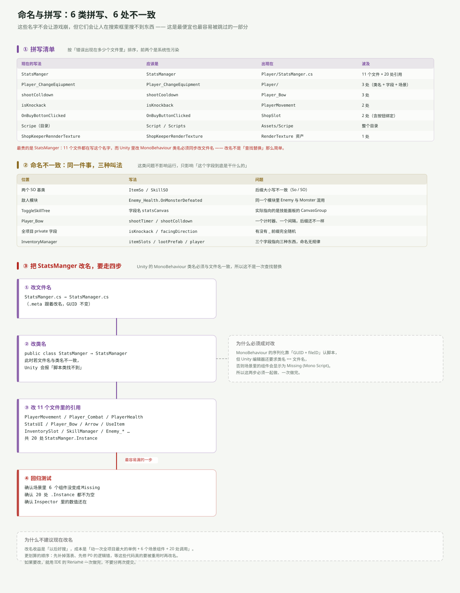

---
title: ARPG 代码分析（二）：6 类拼写与 6 处命名不一致
date: 2026-11-06 20:40:00
tags: Unity, ARPG, 代码审查, 命名规范, C#
summary: StatsManger、Player_ChangeEqiupment、shootColldown、isKnockack、OnBuyBottonClicked、Scripe 目录——6 类拼写错误波及 11 个文件，其中 StatsManger 一家就有 20 处引用，而且在 Unity 里改 MonoBehaviour 类名必须同步改文件名，不是一次查找替换。另外还有 6 处命名不一致：ItemSo 与 SkillSO 后缀大小写不同、Enemy 模块里用 Monster 命名、ToggleSkillTree 的 statsCanvas 实际指向技能面板。
cover: images/arpg-code-c8.svg
pinned: false
draft: false
slug: arpg-code-naming
---

## 一句话说清

拼写错误不会让游戏崩，但它会让**搜索框失效**：你想找「所有管理属性数值的地方」，搜 `Manager` 什么都搜不到。

而且其中一处（`StatsManger`）改名成本极高——因为 Unity 要求 `MonoBehaviour` 的类名与文件名一致，改它要同时动文件、类、11 个文件的引用和 6 个场景组件。

---

## 6 类拼写



| 现在的写法 | 应该是 | 出现在 | 波及 |
|---|---|---|---|
| `StatsManger` | `StatsManager` | `Player/StatsManger.cs` | **11 个文件 + 20 处引用** |
| `Player_ChangeEqiupment` | `Player_ChangeEquipment` | `Player/` | 3 处 |
| `shootColldown` | `shootCooldown` | `Player_Bow` | 3 处 |
| `isKnockack` | `isKnockback` | `PlayerMovement` | 2 处 |
| `OnBuyBottonClicked` | `OnBuyButtonClicked` | `ShopSlot` | 2 处 |
| `Scripe`（目录名） | `Scripts` | `Assets/Scripe` | 整个目录 |

外加一个资产名：`ShopKeeperRennderTexture`（多一个 n）。

### 为什么 `StatsManger` 最贵

它不是一个字段名，是一个**类名 + 文件名 + 20 处引用 + 6 个场景组件**的组合：

- 11 个文件里写着 `StatsManger.Instance`
- 场景里 6 个物体挂着这个组件（`StatsManager` 物体上的那份，以及 `PlayerUI` 相关引用）
- `StatsManger.cs` 这个文件名本身也带着错误

**Unity 的规则是：`MonoBehaviour` 的类名必须与文件名完全一致。** 只改其中一个，编辑器就会告诉你「脚本类找不到」，场景里的组件变成 `Missing (Mono Script)`。

所以改名要按这个顺序一次做完：

1. **改文件名** `StatsManger.cs → StatsManager.cs`（`.meta` 跟着走，GUID 不变）
2. **改类名** `public class StatsManger → StatsManager`（必须在同一次提交里）
3. **改 11 个文件的引用**（IDE 的 Rename 一次做完，别手改）
4. **回归**：确认 6 个组件没变 `Missing`、20 处 `.Instance` 不为空、Inspector 里的数值还在

### 为什么现在不建议改

改名收益是「以后好搜」，成本是「动一次全项目最大的单例 + 6 个场景组件 + 20 处调用」，而且**不改变任何行为**。

对比一下：`SellItem` 改成返回 `bool`（P0 里的第 ③ 条）是 10 行代码、修一个真实 bug；改名是几十处、收益为零行为改变。

**先修会崩的，再谈优雅。**

---

## 6 处命名不一致

这类问题不影响运行，只影响「这个字段到底是干什么的」。

| 位置 | 写法 | 问题 |
|---|---|---|
| 两个 SO 基类 | `ItemSo` / `SkillSO` | 后缀大小写不一致（So / SO） |
| 敌人模块 | `Enemy_Health.OnMonsterDefeated` | 同一模块里 `Enemy` 与 `Monster` 混用 |
| `ToggleSkillTree` | 字段名 `statsCanvas` | 实际指向技能面板的 `CanvasGroup` |
| `Player_Bow` | `shootTimer` / `shootColldown` | 一个计时器、一个间隔，后缀还不统一 |
| 全项目 private 字段 | `isKnockack` / `facingDirection` | 有没有 `_` 前缀完全随机 |
| `InventoryManager` | `itemSlots` / `lootPrefab` / `player` | 三个字段指向三种东西，命名无规律 |

其中最容易害人的是第三条：

```csharp
public class ToggleSkillTree : MonoBehaviour
{
    public CanvasGroup statsCanvas;   // ← 名字是 stats，实际是技能面板
```

从 `StatsUI` 复制过来忘了改名。以后有人看到 `statsCanvas` 以为「这是属性面板」，就会在两个面板之间串线。

---

## 命名里藏着的两个「语义漂移」

比拼写更值得注意的，是**名字承诺的东西和代码做的事不一样**。

### ① `OnMonsterDefeated` 在敌人模块里

整个敌人模块都叫 `Enemy_*`（`Enemy_Health`、`Enemy_Combat`、`Enemy_Movement`、`Enemy_Knockback`），只有事件叫 `OnMonsterDefeated`。

这意味着：以后加「Boss」「中立生物」「召唤物」时，你得先想一下「这东西算 Monster 吗」。

### ② `ItemSo.damage` 从不生效

字段名叫 `damage`，商店悬停框也真的会显示 `Damage+X`，但 `UseItem.ApplyItemEffects()` 里没有一行处理它。

**名字承诺了一个效果，代码没实现。** 这比拼写错误危险得多，因为它骗的是「读代码的人」。

---

## 一个可以立刻做的低成本改进

不需要动类名、不需要碰场景：

```csharp
// 在 StatsManger 类里加一个别名常量，新代码先用对的名字
public static StatsManger Instance;   // 保持不动（场景在引用）
```

真正零成本的是**统一 private 字段风格**和**修注释里的错别字**——这两类改动不碰任何序列化数据，随便改。

---

## 一句话总结

6 类拼写里，5 类可以随时改（字段名、私有变量、注释）；只有 `StatsManger` 一个动不了——因为它是 MonoBehaviour 类名，绑着文件名、场景 GUID 和 20 处引用。

**判据很简单：名字是否出现在场景序列化数据里。在，就贵；不在，就便宜。**

下一篇：[八个反模式](arpg-code-antipatterns.html)。
