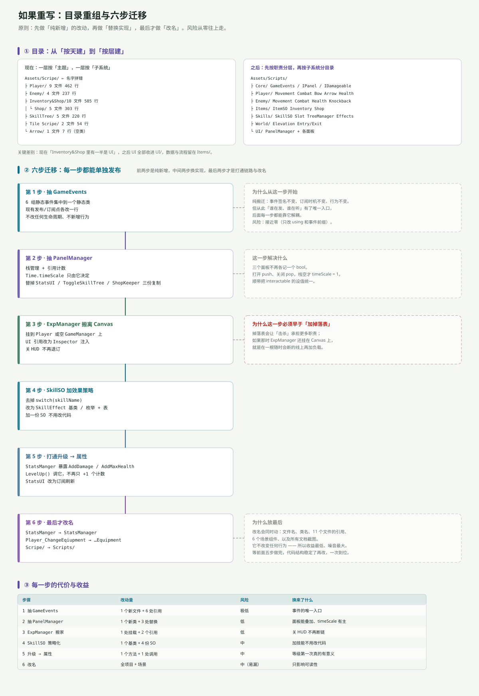

---
title: ARPG 代码分析（四）：如果重写——目录重组与六步迁移
date: 2026-11-06 22:00:00
tags: Unity, ARPG, 代码审查, 重构, 架构
summary: 不改功能的条件下，把 31 个文件重新组织：目录从「按天建」改成「按层建」，迁移拆成六步，按风险从零往上排——先做纯新增（GameEvents、PanelManager），再换实现（ExpManager 搬家、SkillSO 策略化），然后才打通「升级→属性」，最后才改名。每步都给出改动量、风险和换来了什么，并说明为什么不能反过来做。
cover: images/arpg-code-c10.svg
pinned: false
draft: false
slug: arpg-code-refactor
---

## 一句话说清

重写的顺序比重写的内容重要。**先做「纯新增」，再做「替换实现」，最后做「改名」**——因为这个顺序下，每一步都能单独发布、单独回滚。

反过来做（先改名、再动结构）会导致：改了 60 处名字，代码结构一点没变，还多了一次大 diff。

---

## 目录：从「按天建」到「按层建」



### 现在

```
Assets/Scripe/            ← 名字拼错（Script）
├ Player/        9 文件 462 行
├ Enemy/         4 文件 237 行
├ Inventory&Shop/10 文件 585 行
│  └ Shop/       5 文件 303 行
├ SkillTree/     5 文件 220 行
├ Tile Scripe/   2 文件  54 行
└ Arrow/         1 文件   7 行（空类）
```

问题不是「目录太多」，是**分类维度不统一**：`Player` / `Enemy` 按「是谁」分，`Inventory&Shop` 按「干什么」分，`Tile Scripe` 按「放在哪」分。

后果是 `Inventory&Shop` 里一半是 UI（`InventorySlot`、`ShopInfo`、`ShopSlot`），另一半是数据与流程（`ItemSo`、`InventoryManager`、`ShopManager`）。**你没法用「UI」这个词一次找全所有 UI。**

### 之后

```
Assets/Scripts/
├ Core/         GameEvents / IPanel / IDamageable
├ Player/       Movement Combat Bow Arrow Health
├ Enemy/        Movement Combat Health Knockback
├ Items/        ItemSO Inventory Shop
├ Skills/       SkillSO Slot TreeManager Effects
├ World/        Elevation Entry/Exit
└ UI/           PanelManager + 各面板
```

关键差别：**先按职责分层（Core / 逻辑 / UI），再按子系统分目录**。`UI/` 一个目录就能回答「界面上有什么」。

---

## 六步迁移

每一步都能单独提交、单独发布。

### 第 1 步 · 抽 `GameEvents`

```csharp
public static class GameEvents
{
    public static event Action<int> MonsterDefeated;
    public static event Action<int> LevelUp;
    public static event Action<SkillSlot> AbilityPointSpent;
    public static event Action<SkillSlot> SkillMaxed;
    public static event Action<ItemSo, int> ItemLooted;
    public static event Action<ShopManager, bool> ShopStateChanged;
}
```

**改什么**：6 组事件集中到一个静态类；发布/订阅点各改一行（`Enemy_Health.OnMonsterDefeated` → `GameEvents.MonsterDefeated`）。

**为什么放第一步**：纯搬迁——事件签名不变、订阅时机不变、行为不变。但从此「谁在发、谁在听」有了唯一入口，后面五步都能靠它解耦。

**风险**：接近零（只改 `using` 和前缀）。

### 第 2 步 · 抽 `PanelManager`

```csharp
public class PanelManager : MonoBehaviour
{
    private readonly Stack<CanvasGroup> open = new Stack<CanvasGroup>();

    public void Push(CanvasGroup panel)
    {
        open.Push(panel);
        panel.alpha = 1; panel.blocksRaycasts = true; panel.interactable = true;
        Time.timeScale = 0;
    }

    public void Pop(CanvasGroup panel)
    {
        if (open.Count > 0 && open.Peek() == panel) open.Pop();
        panel.alpha = 0; panel.blocksRaycasts = false; panel.interactable = false;
        if (open.Count == 0) Time.timeScale = 1;   // ← 只有栈空才恢复
    }
}
```

**改什么**：`StatsUI` / `ToggleSkillTree` / `ShopKeeper` 三份复制代码各删掉一半。

**解决什么**：三个面板不再各记一个 `bool`；`timeScale` 只有一个主人；`interactable` 的设值统一（顺手修掉「两个面板少设一行」的不一致）。

**风险**：低。但要逐个验证「先开 A 再开 B、关 B」的序列。

### 第 3 步 · `ExpManager` 搬离 Canvas

**改什么**：把组件从 `ExpCanvas` 移到 `Player` 或一个空 `GameManager`；`expSlider` / `currentLevelText` 改为 Inspector 注入（跨物体引用）。

**为什么必须早于「加掉落表」**：掉落表会让「击杀」承担更多职责。如果那时 `ExpManager` 还挂在 Canvas 上，就是在一根随时会断的线上再加负载。

**风险**：低（1 处挂载 + 2 个引用），但必须重跑一次「关 HUD 后打怪」的验证。

### 第 4 步 · `SkillSO` 加效果策略

```csharp
public abstract class SkillEffect : ScriptableObject
{
    public abstract void Apply();
}

// MaxHealthEffect : SkillEffect  → StatsManger.Instance.AddMaxHealth(1)
// UnlockCombat  : SkillEffect     → 打开近战
```

**改什么**：去掉 `switch(skillName)`；4 份 SO 各挂一个 effect 资产。

**解决什么**：以后加一份技能 SO 不用改代码。现在 24 个格子里 8 个落进 `default`，就是因为「名字不在 switch 里」。

**风险**：中（要给 4 份 SO 重新配 effect）。

### 第 5 步 · 打通「升级 → 属性」

```csharp
// StatsManger 新增
public void AddMaxHealth(int n) { maxHealth += n; healthText.text = ...; OnStatsChanged?.Invoke(); }
public void AddDamage(int n)    { damage += n;    OnStatsChanged?.Invoke(); }

// ExpManager.LevelUp() 末尾
stats.AddMaxHealth(1);
```

**改什么**：`StatsManger` 暴露几个 `AddXxx`；`LevelUp()` 调它；`StatsUI` 改成订阅 `OnStatsChanged` 刷新。

**解决什么**：等级第一次真的有意义；属性面板不再显示开局快照。

**风险**：中（会影响手感，得重新调数值）。

### 第 6 步 · 最后才改名

```
StatsManger → StatsManager
Player_ChangeEqiupment → Player_ChangeEquipment
Scripe/ → Scripts/
```

**为什么放最后**：改名会同时动文件名、类名、11 个文件的引用、6 个场景组件，以及所有文档截图。**它不改变任何行为**——收益最低、噪音最大。

等前面五步做完、结构稳定了再改，一次到位。

---

## 每一步的代价与收益

| 步骤 | 改动量 | 风险 | 换来了什么 |
|---|---|---|---|
| 1 抽 `GameEvents` | 1 个新文件 + 6 处引用 | 极低 | 事件的唯一入口 |
| 2 抽 `PanelManager` | 1 个新类 + 3 处替换 | 低 | 面板能叠加、`timeScale` 有主 |
| 3 `ExpManager` 搬家 | 1 处挂载 + 2 个引用 | 低 | 关 HUD 不再断链 |
| 4 `SkillSO` 策略化 | 1 个基类 + 4 份 SO | 中 | 加技能不用改代码 |
| 5 升级 → 属性 | 1 个方法 + 1 处调用 | 中 | 等级第一次真的有意义 |
| 6 改名 | 全项目 + 场景 | 中（易漏） | 只影响可读性 |

前两步加起来大约 80 行新代码，风险极低，但能一次性解决「面板互斥」和「事件散落」两个结构性问题。**这是性价比最高的部分。**

---

## 明确不建议做的三件事

**① 不要先改名。** 理由见第 6 步。

**② 不要把 `public` 字段一次性全改成 `GetComponent`。** 跨物体的引用改不成 `GetComponent`，硬改会把「漏拖」变成「空引用」——问题没解决，只是换了报错的位置。**按「同一物体」和「跨物体」分批改。**

**③ 不要在没有存档系统之前做「数值重做」。** 现在 `level` / `gold` / `availablePoints` 全在内存里，重开归零；数值调得再好，玩家也留不下来。

---

## 真正的顺序

如果只能做一件事，做这个：

**补一张掉落表，把「敌人 → 物品」那条缺失的边接上。**

它同时解决三件事：让「打怪」有回报、让物品链有了稳定来源、让 `Loot` / `InventoryManager` 的代码第一次真的被用到。

然后再按第 1、2、3 步做结构收敛。剩下四步（策略化、打通升级、改名）可以慢慢来——**它们不改变「玩起来对不对」，只改变「改起来累不累」。**

---

## 一句话总结

重构的目标不是「代码好看」，是**让下一个改动只需要改一处**。

按这个标准衡量：抽 `GameEvents`（6 处变 1 处）、抽 `PanelManager`（3 份变 1 份）、`StatsManger` 暴露 `AddXxx`（属性只有一个写入口）——这三件事都在把「多处」变「一处」。而改名只是把「一处」写得更顺眼。

回到体检报告：[31 个文件的一次静态体检](arpg-code-audit.html)。
