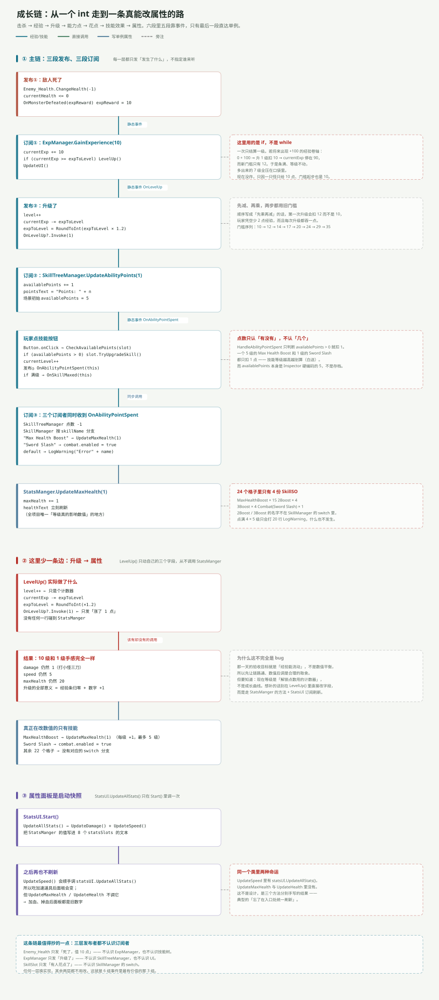

---
title: ARPG 模块专文（三）：成长链——一个 int 走完五段
date: 2026-11-05 22:00:00
tags: Unity, ARPG, 游戏开发, 经验系统, 技能树, 事件
summary: 从击杀到「攻击力+1」中间隔了五段：敌人广播 expReward → ExpManager 累加经验并升级 → 发 OnLevelUp → SkillTreeManager 发点数 → 玩家点技能 → SkillManager 改 StatsManger。三段发布、三段订阅，靠三组静态事件串起来。同时指出这条链上的三个硬伤：升级从不碰属性、24 个格子只有 4 份 SkillSO、属性面板是启动快照。
cover: images/arpg-mod-c3.svg
pinned: false
draft: false
slug: arpg-module-growth
---

## 一句话说清

成长链不是一条直线，是**三段「发布—订阅」串起来的接力**：

`敌人死 → 经验 → 升级 → 能力点 → 花点 → 技能效果 → 属性`

每一段都只发「发生了什么」，不指定谁来听。所以它能跑通，但也因此很难追——你没法在 `LevelUp()` 里按 Ctrl+F 找到「谁改了攻击力」，因为那里根本没有这行代码。

---

## 全链一张图



---

## 第一段：敌人只说「我死了」

```csharp
public int expReward = 10;
public delegate void MonsterDefeated(int amount);
public static event MonsterDefeated OnMonsterDefeated;

if (currentHealth <= 0)
{
    OnMonsterDefeated(expReward);
    Destroy(gameObject);
}
```

`expReward` 写在**敌人**身上而不是玩家身上，理由是「值多少」属于敌人的配置，「怎么用」才是玩家的规则。

整条载荷只有一个 `int`。`Enemy_Health` 不认识 `ExpManager`，连它的类型都没出现在 `using` 里——这是全工程唯一一处完全解耦的边。

---

## 第二段：ExpManager 累加与升级

```csharp
public void GainExperience(int amount)
{
    currentExp += amount;
    if (currentExp >= expToLevel) { LevelUp(); }
    UpdateUI();
}

private void LevelUp()
{
    level++;
    currentExp -= expToLevel;
    expToLevel = Mathf.RoundToInt(expToLevel * expGrowthMultiplier);
    OnLevelUp?.Invoke(1);
}
```

三个细节值得停一下：

**① `expToLevel` 是「本级门槛」，不是「累计经验」。** 所以升级时是 `currentExp -= expToLevel`（把刚跨过的那道坎扣掉），进度条用 `expSlider.maxValue = expToLevel`（满格 = 本级满）。

**② 顺序是「先减、再乘」，两步都用旧门槛。** 写反了会吞经验，而且每次都吞一点，很难查。

**③ 门槛序列：** `10 → 12 → 14 → 17 → 20 → 24 → 29 → 35 → 42 → 50`。`RoundToInt` 把 ×1.2 打成了台阶。

---

## 第三段：点数与技能

`OnLevelUp?.Invoke(1)` 被 `SkillTreeManager` 接住：

```csharp
private void OnEnable() { ExpManager.OnLevelUp += UpdateAbilityPoints; }

public void UpdateAbilityPoints(int amount)
{
    availablePoints += amount;
    pointsText.text = "Points: " + availablePoints;
}
```

玩家点格子走的是另一条路：`SkillTreeManager.Start()` 里给每个格子的按钮绑了监听。

```csharp
foreach (SkillSlot slot in skillSlots)
    slot.skillButton.onClick.AddListener(() => CheckAvailablePoints(slot));
```

然后 `SkillSlot.TryUpgradeSkill()` 才是真正花点的地方：

```csharp
if (isUnlocked && currentLevel < skillSO.maxLevel)
{
    currentLevel++;
    OnAbilityPointSpent?.Invoke(this);
    if (currentLevel >= skillSO.maxLevel) { OnSkillMaxed?.Invoke(this); }
    UpdateUI();
}
```

注意 `OnAbilityPointSpent` 是在**扣点之前**发的，真正扣点的动作在订阅者里：

```csharp
private void HandleAbilityPointSpent(SkillSlot slot)
{
    if (availablePoints > 0) { UpdateAbilityPoints(-1); }
}
```

---

## 三个订阅者同时收到同一个事件

`OnAbilityPointSpent` 有两个订阅者，加上发布者自己就是三方：

| 订阅者 | 收到后做什么 |
|---|---|
| `SkillTreeManager` | 点数 −1 |
| `SkillManager` | 按 `skillName` 分支，改属性 |
| `SkillSlot`（自己） | 判满级，满了再发 `OnSkillMaxed` |

`SkillManager` 里那个 `switch` 就是整个成长链唯一真正改属性的地方：

```csharp
switch (skillName)
{
    case "Max Health Boost": StatsManger.Instance.UpdateMaxHealth(1); break;
    case "Sword Slash":      combat.enabled = true;                  break;
    default: Debug.LogWarning("Error" + skillName);                  break;
}
```

**到目前为止，升级一共只带来两样东西：能力点 +1、以及点数花出去以后血上限 +1。** 攻击力、移速、耐打程度全都没动。

---

## 24 个格子，4 份 SkillSO

场景里 24 个 `SkillSlot`，但它们只挂了 4 份资产：

| SkillSO | skillName | maxLevel | 用它的格子数 |
|---|---|---|---|
| `MaxHealthBoost` | Max Health Boost | 5 | 15 |
| `2Boost` | 2Boost | 5 | 4 |
| `3Boost` | 3Boost | 5 | 4 |
| `Combat` | Sword Slash | 1 | 1 |

`2Boost` 和 `3Boost` 这两个名字**不在 `SkillManager` 的 switch 里**，所以点满它们只会打 20 行 `LogWarning("Error2Boost")`，什么也不发生。

加上 `availablePoints` 在 Inspector 里被硬编码成 5（不是存档、不跟等级走），这块面板现在的实际作用是「一个能加点血上限的 24 格占位图」。

---

## 前置解锁：只判「前置满了」，不判点数

```csharp
public bool CanUnlockSkill()
{
    foreach (SkillSlot slot in prerequisiteSkillSlots)
        if (!slot.isUnlocked || slot.currentLevel < slot.skillSO.maxLevel)
            return false;
    return true;
}
```

`HandleSkillMaxed` 在某个技能满级时，对所有未解锁且满足前置的格子调一次 `Unlock()`。

24 个格子里 15 个没有前置、9 个有 1 个前置。所以「点亮第一个技能」之后会连锁解锁一批——但解锁不等于能点，点还是要花点数。

---

## 属性面板为什么永远显示旧数字

`StatsUI.UpdateAllStats()` 只在 `Start()` 里被调一次：

```csharp
private void Start() { UpdateAllStats(); }
```

之后只有 `StatsManger.UpdateSpeed()` 会顺手调它：

```csharp
public void UpdateSpeed(int amount)
{
    speed += amount;
    statsUI.UpdateAllStats();   // 只有这个更新面板
}
```

而 `UpdateMaxHealth()` 和 `UpdateHealth()` 里**没有这一行**。

结果：吃加速道具 → 面板刷新；升级加血上限 → 面板不动。同一个类里三个方法，两种命运，纯粹是分别手写的结果。

---

## 这条链上最该补的一处

`LevelUp()` 只动 `level` / `currentExp` / `expToLevel` 三个字段，从不调用 `StatsManger`。所以：

- 10 级和 1 级的手感完全一样
- `level` 目前是个「解锁点数用的计数器」，不是成长曲线

补法不是在 `LevelUp()` 里直接改字段——那会让 `StatsUI` 继续显示旧值。正确的链条是：

`升级 → StatsManger 暴露 AddDamage / AddMaxHealth 之类的方法 → StatsUI 订阅刷新`

---

## 一句话总结

成长链的骨架是三组静态事件：`OnMonsterDefeated`、`OnLevelUp`、`OnAbilityPointSpent`。它们让「敌人 / 经验 / 技能」三方互不认识，这是全工程最干净的设计；但也让「升级到底改了什么」这个问题必须顺着三张表一路查下去才能回答——答案是：**只改了血上限，而且还只改一次。**

下一篇：[物品与商店](/post/arpg-module-items-shop.html)。
