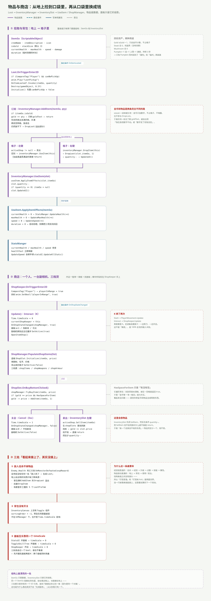

---
title: ARPG 模块专文（四）：物品与商店——从地上捡到换成钱
date: 2026-11-05 22:30:00
tags: Unity, ARPG, 游戏开发, 背包系统, 商店系统, ScriptableObject
summary: 物品模块是全场最长的一条链：Loot 触发器发 OnItemLooted → InventoryManager 分流金币/堆叠/空格/溢出 → InventorySlot 左键使用或卖出、右键丢弃 → UseItem 改 StatsManger；商店则是 ShopKeeper 触发圈 + K 开店 + OnShopStateChanged 通知背包「现在开着哪家店」。同时指出三处断链（击杀不掉物品、卖出不校验导致物品蒸发、背包没有开关）和两处实现 bug（空格能塞超 stackSize、ShopInfo 用 SO 名而不是 itemName）。
cover: images/arpg-mod-c4.svg
pinned: false
draft: false
slug: arpg-module-items-shop
---

## 一句话说清

物品模块的核心思想只有一句：**`ItemSo` 是数据，`InventorySlot` 只是它的投影。**

同一个 `ItemSo` 资产能躺在背包格里、挂在商店格上、也能躺在地上——三处都只是持有同一个 SO 引用，谁也不复制数据。所以改一次图标，三处一起变。

商店链则完全独立：它不改数据，只做「加减金币 + 调 `AddItem`」。

---

## 全链一张图



---

## 数据结构：一个 SO 撑起整个模块

```csharp
[CreateAssetMenu(fileName = "New Item")]
public class ItemSo : ScriptableObject
{
    public string itemName;
    [TextArea] public string itemDescription;
    public Sprite icon;
    public bool isGold;
    public int stackSize = 3;
    [Header("Stats")]
    public int currentHealth, maxHealth, speed, damage;
    [Header("For Temporary Items")]
    public float duration;
}
```

工程里只有 4 份资产：

| 资产 | 属性 | 实际效果 |
|---|---|---|
| `Gold` | `isGold = 1` | 只加金币计数，不占格子 |
| `Steak` | 全 0 | 纯道具，用了什么都不会发生 |
| `Mushroom` | 全 0 | 同上 |
| `Pumpkin` | `+1 血 / +1 上限 / +1 速度 / 5 秒` | 唯一一个真能改属性的 |

---

## 拾取：触发器 + 静态事件

```csharp
private void OnTriggerEnter2D(Collider2D collision)
{
    if (collision.CompareTag("Player") && canBePickUp)
    {
        anim.Play("LootPickup");
        OnItemLooted?.Invoke(itemSo, quantity);
        Destroy(gameObject, 0.5f);
    }
}
```

注意这里用了 `?.Invoke`——和敌人死亡那个裸调用正好相反。而且 `Initialize()` 会把 `canBePickUp` 先置为 `false`，防止刚扔出去的同帧被自己再捡回来。

事件被 `InventoryManager` 接住：

```csharp
private void OnEnable()  { Loot.OnItemLooted += AddItem; }
private void OnDisable() { Loot.OnItemLooted -= AddItem; }
```

---

## AddItem：四道分流

```csharp
public void AddItem(ItemSo itemSo, int quantity)
{
    if (itemSo.isGold) { gold += quantity; goldText.text = gold.ToString(); return; }

    foreach (var slot in itemSlots)            // ① 找同类未满格，补满
        if (slot.itemSo == itemSo && slot.quantity < itemSo.stackSize) { ... }

    foreach (var slot in itemSlots)            // ② 找空格，整批塞进去
        if (slot.itemSo == null)
        {
            int amountToAdd = Mathf.Min(itemSo.stackSize, quantity);
            slot.itemSo = itemSo;
            slot.quantity = quantity;        // ← 不是 amountToAdd
            slot.UpdateUI();
            return;
        }

    if (quantity > 0) DropLoot(itemSo, quantity);   // ③ 全满，溢出回地上
}
```

第 ② 步有个实现 bug：算出了 `amountToAdd`，赋值时却用了 `quantity`。**结果是一个空格能塞下超过 `stackSize` 的数量**（`stackSize = 3` 时塞进 10 个）。

---

## 使用：格子自己决定「这是用还是卖」

```csharp
public void OnPointerClick(PointerEventData eventData)
{
    if (quantity > 0 && eventData.button == PointerEventData.InputButton.Left)
    {
        if (activeShop != null) { activeShop.SellItem(itemSo); quantity--; UpdateUI(); }
        else { inventoryManager.UseItem(this); }
    }
    else if (eventData.button == PointerEventData.InputButton.Right)
        inventoryManager.DropItem(this);
}
```

`activeShop` 从哪来？从事件来：

```csharp
private void OnEnable()  { ShopKeeper.OnShopStateChanged += HandleShopStateChanged; }
private void HandleShopStateChanged(ShopManager shopManager, bool isOpen)
{
    activeShop = isOpen ? shopManager : null;
}
```

于是同一个左键，在店外是「吃」，在店内是「卖」。**背包格自己不知道有没有开店，它只知道 `activeShop` 是不是空的。**

`UseItem.ApplyItemEffects()` 再往下一层：

```csharp
if (itemSo.currentHealth > 0) StatsManger.Instance.UpdateHealth(itemSo.currentHealth);
if (itemSo.maxHealth > 0)     StatsManger.Instance.UpdateMaxHealth(itemSo.maxHealth);
if (itemSo.speed > 0)         StatsManger.Instance.UpdateSpeed(itemSo.speed);
if (itemSo.duration > 0)      StartCoroutine(EffectTimer(itemSo, itemSo.duration));
```

`EffectTimer` 到期后把三项**反向扣回去**——所以「临时增益」的实现方式是「加一次、减一次」，中途没有任何状态记录。如果到期前又吃了第二个同类道具，两个协程会各自扣一次，属性就回不去了。

---

## 商店：五步开店

| 步骤 | 谁 | 做了什么 |
|---|---|---|
| ① 进圈 | `ShopKeeper.OnTriggerEnter2D` | `playerInRange = true`，同时播动画 |
| ② 按 K | `ShopKeeper.Update` | `timeScale = 0`、`currentShopKeeper = this`、发 `OnShopStateChanged(shopManager, true)` |
| ③ 亮面板 | 同上 | `alpha = 1`、`blocksRaycasts = true`、副相机就位并 `SetActive(true)` |
| ④ 填货 | `OpenItemShop()` | `shopManager.PopulateShopItems(shopItems)` |
| ⑤ 关店 | 按 Esc | `timeScale = 1`、发 `false`、面板 α=0、副相机关掉 |

填货是把静态配置铺到格子上的过程：

```csharp
public void PopulateShopItems(List<ShopItems> shopItems)
{
    for (int i = 0; i < shopItems.Count && i < shopSlots.Length; i++)
    {
        shopSlots[i].Initialize(shopItems[i].itemSo, shopItems[i].price);
        shopSlots[i].gameObject.SetActive(true);
    }
    for (int i = shopItems.Count; i < shopSlots.Length; i++)
        shopSlots[i].gameObject.SetActive(false);
}
```

买与卖都在 `ShopManager` 里，但两者的严谨程度差得很远：

```csharp
public void TryBuyItem(ItemSo itemSo, int price)
{
    if (itemSo != null && inventoryManager.gold >= price && HasSpaceForItem(itemSo))
    {
        inventoryManager.gold -= price;
        inventoryManager.goldText.text = inventoryManager.gold.ToString();
        inventoryManager.AddItem(itemSo, 1);
    }
}

public void SellItem(ItemSo itemSo)
{
    if (itemSo == null) return;
    foreach (var slot in shopSlots)
        if (slot.itemSo == itemSo) { inventoryManager.gold += slot.price; return; }
}
```

**买入查了三件事（东西存在、钱够、有空位），卖出只查「店里同款」——而且找不到时直接 `return`，不告诉调用方。**

---

## 三处断链

**① 敌人击杀不掉物品。** 全工程没有任何一处「敌人死了 → 生成 `Loot`」。地上会出现的 `Loot` 只有三种来源：背包满时的 `DropLoot` 溢出、右键 `DropItem`、以及场景里手工摆的 5 个预制体。

这是整个 ARPG 里最值得先补的一条——两条通了的链（打怪→变强 / 拾取→成长）之间，就差一张掉落表。

**② 卖出会吞物品。** `InventorySlot` 先调 `SellItem`，然后**无条件** `quantity--`。而 `SellItem` 在「这家店不收这件东西」时什么都不做就返回。于是卖一个店里没有的东西 = 物品凭空少一个、金币不变。

根因是 `SellItem` 返回 `void`，调用方无法知道成功与否。

**③ 背包没有开关。** `InventoryCanvas` 上没有 Toggle 组件，`sortingOrder = −1`，常驻在场景最底层。它不在 `UIManager` 下，也不受 `Time.timeScale` 影响。

---

## 还有两个小问题

**`ShopInfo` 用错了字段。** 悬停框的标题取的是 `itemSo.name`（SO 资产名），而商店格子显示的是 `itemSo.itemName`。两个字段一旦不一致，几处文案就会对不上。

**面板互斥靠同一个 `timeScale`。** `StatsUI`、`ToggleSkillTree`、`ShopKeeper` 三处各自 `timeScale = 0`，各自记一个 bool，谁也不看谁。先开属性面板再按 K，两个面板会同时亮着。

---

## 这个模块与外界的接缝

| 方向 | 接口 | 形态 |
|---|---|---|
| 入（世界 → 背包） | `OnItemLooted(ItemSo, int)` | 静态事件 |
| 内（背包 → 属性） | `StatsManger.UpdateHealth / UpdateMaxHealth / UpdateSpeed` | 单例写入 |
| 内（背包 ↔ 商店） | `ShopManager.TryBuyItem / SellItem / AddItem` | 直接调用 |
| 入（商店 → 背包） | `OnShopStateChanged(ShopManager, bool)` | 静态事件 |
| 出（商店 → 世界） | `PopupShopItems`、`shopCanvasGroup`、`shopkeeperCam` | 直接引用 |

**物品模块是全场唯一一个「既发事件、又订阅事件、又写单例、又调别人方法」的模块**——四种接线方式全用上了。这也是它行数最多的原因（`InventoryManager` 98 行，全场最长）。

---

## 一句话总结

物品模块的设计分两半：**数据那一半（`ItemSo` + 投影）很干净**，同一个 SO 在三处共用、不复制；**流程那一半（买卖、金币、面板）很松**，`SellItem` 不返回结果、金币走独立分支、面板没有开关。

想让这个模块真正立起来，顺序是：先补掉落表（接通两条链）→ 再让买卖返回成功与否（堵住物品蒸发）→ 最后给背包加开关并统一面板互斥。

回到总览：[7 个模块的全景与五类接线](/post/arpg-modules-overview.html)。
