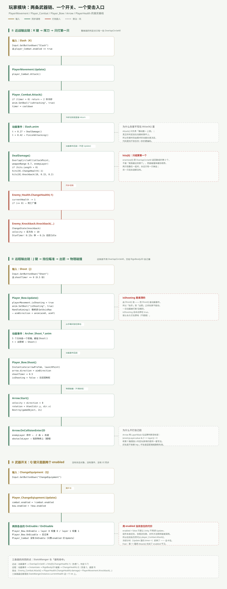
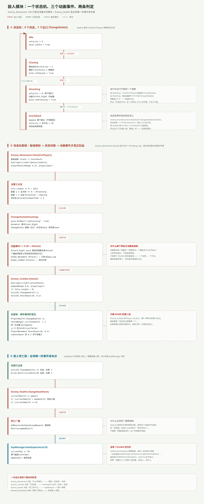

---
title: ARPG 模块专文（二）：玩家与敌人——两条武器链、一个状态机
date: 2026-11-05 21:30:00
tags: Unity, ARPG, 游戏开发, 战斗系统, 状态机, 动画事件
summary: 把玩家（5 个脚本）和敌人（4 个脚本）当成两个模块拆开讲：玩家有近战和远程两条武器链，共同点是「伤害判定都挂在动画事件上」，区别是近战用 OverlapCircleAll、远程用物理碰撞；敌人是 4 态状态机，攻击由 Attack_Right.anim 里的三个动画事件驱动，其中两个同名 Attack() 会同时被广播。配两张图：玩家三条链、敌人状态机与两条判定。
cover: images/arpg-mod-c2.svg
pinned: false
draft: false
slug: arpg-module-player-enemy
---

## 一句话说清

玩家和敌人这两个模块，外表看是「谁打谁」，实际是**四个脚本各管一件事**：

- `PlayerMovement` 决定「能不能动」
- `Player_Combat` 决定「打没打中」
- `Enemy_Movement` 决定「什么时候打」
- `Enemy_Health` 决定「死了给什么」

分清楚之后，那些看起来像 bug 的行为（打两下不死、卡在原地不动、敌人打完不回 Idle）都能一眼定位到是哪个脚本没接上。

---

## 玩家模块：5 个脚本、3 条链

| 脚本 | 行数 | 职责 |
|---|---|---|
| `PlayerMovement` | 71 | 读输入、写 `rb.velocity`、翻转朝向、被击退 |
| `Player_Combat` | 62 | 冷却、播动画、`OverlapCircleAll` 判定 |
| `Player_Bow` | 71 | 八向瞄准、出箭、切动画层 |
| `Arrow` | 56 | 飞行、碰撞、插墙 |
| `PlayerHealth` | 24 | 扣血、刷 HP 文本、死亡隐藏 |



**这三条链的输入全是同一个来源**——`InputManager.asset` 里的轴。`PlayerMovement`、`Player_Bow`、`Player_ChangeEqiupment` 三个脚本各自在自己的 `Update()` 里轮询输入，没有统一的输入层。

---

## 近战链：动画事件才是判定点

`Attack()` 里没有伤害，这是第一个反直觉的地方：

```csharp
public void Attack()
{
    if (timer <= 0)
    {
        anim.SetBool("isAttacking", true);
        timer = cooldown;   // 2 秒
    }
}
```

它只做两件事：播动画、上冷却锁。真正的伤害在 `Slash.anim` 的帧事件里：

```
t = 0.27  → DealDamage()
t = 0.42  → FinishAttacking()
```

`DealDamage()` 才是判定：

```csharp
Collider2D[] enemies = Physics2D.OverlapCircleAll(
    attackPoint.position, StatsManger.Instance.weaponRange, enemyLayer);

if (enemies.Length > 0)
{
    enemies[0].GetComponent<Enemy_Health>().ChangeHealth(-StatsManger.Instance.damage);
    enemies[0].GetComponent<Enemy_Knockback>().Knockback(
        transform, StatsManger.Instance.knockbackForce,
        StatsManger.Instance.knockbackTime, StatsManger.Instance.stunTime);
}
```

这个写法的好处：**伤害时刻由美术的动画长度决定**，代码里找不到「等 0.3 秒」这种硬编码。改动画就是改手感。

代价是：**代码里看不出伤害发生在什么时候**。只读 `Player_Combat.cs`，你会以为 `Attack()` 一调就掉血；必须打开 `Slash.anim` 才知道真实时序。

---

## 远程链：交给物理引擎

远程链不需要 `OverlapCircleAll`，因为箭是真实的 `Rigidbody2D`：

| 阶段 | 谁做的 | 关键行 |
|---|---|---|
| 瞄准 | `Player_Bow.HandleAiming()` | `GetAxisRaw` → `aimDirection` → `anim.SetFloat(aimX, aimY)` |
| 出手 | `Player_Bow.Shoot()`（动画事件） | `Instantiate(arrowPrefab, launchPoint.position)` |
| 飞行 | `Arrow.Start()` | `velocity = direction * 8`，`Destroy(gameObject, 2)` |
| 命中 | `Arrow.OnCollisionEnter2D` | 层位运算判断 `enemyLayer` / `obstacleLayer` |

`Arrow` 的层判断用的是位运算，和敌人的判定是同一种写法：

```csharp
if ((enemyLayer.value & (1 << collision.gameObject.layer)) > 0)
{
    collision.gameObject.GetComponent<Enemy_Health>().ChangeHealth(-damage);
    collision.gameObject.GetComponent<Enemy_Knockback>().Knockback(...);
}
```

好处是不依赖 tag，只用 Layer；坏处是**层配错就静默失效**——箭穿过去，什么都不会发生，也不报错。

---

## 武器切换：Q 键只是翻两个 enabled

```csharp
void Update()
{
    if (Input.GetButtonDown("ChangeEquipment"))
    {
        combat.enabled = !combat.enabled;
        bow.enabled = !bow.enabled;
    }
}
```

加上 `Player_Bow` 的 `OnEnable` / `OnDisable` 负责切动画层权重（0 → 1），整套切换就完成了。

但 `enabled` 不是状态位，它只控制** Unity 是否调用该组件的 `Update` / `OnEnable` 等回调**：
- 组件还在、协程还在跑
- 对外方法照样能被调用（`player_Combat.Attack()` 在别处仍可调）
- `Player_Combat.Update()` 里的冷却计时会停——切回来时 timer 保留旧值

第 11 篇给 `Attack()` 补了 `enabled` 守卫，就是为了堵住「禁用状态下仍能攻击」这条路。

---

## 受击链：敌人打你的那一条

受击不在玩家模块里发起，而是敌人主动：

```
Enemy_Combat.Attack()
  → OverlapCircleAll(attackPoint, 0.8, playerLayer)
  → hits[0].GetComponent<PlayerHealth>().ChangeHealth(-3)
  → hits[0].GetComponent<PlayerMovement>().Knockback(transform, 10, 0.2)
```

玩家侧分两件事同时发生：
- `PlayerHealth.ChangeHealth(-3)`：改 `StatsManger.currentHealth`，播 `TextUpdate`，≤ 0 就 `SetActive(false)`
- `PlayerMovement.Knockback(...)`：`isKnockback = true` → 锁 0.2 秒不读输入 → 协程结束后解锁

这里有个不对称：**敌人打玩家给 3 点伤害，玩家打敌人给 1 点**。玩家 20 血，敌人 3 血——被怪打一下要挨七下才死，打死一只怪要砍三刀。数值上「怪很硬、人很脆」的感觉其实是反的。

---

## 敌人模块：4 态状态机



`Enemy_Movement` 是全工程最长的脚本（140 行），核心就是这个状态机：

| 状态 | 行为 | 谁把状态切走的 |
|---|---|---|
| `Idle` | `velocity = 0` | 感知到玩家且距离 > 2 → `Chasing` |
| `Chasing` | 朝玩家跑，翻转朝向 | 距离 ≤ 2 且冷却好 → `Attacking` |
| `Attacking` | `velocity = 0`，播 `Attack_Right` | **动画事件** `t = 0.59` → `ChangeState(0)` |
| `knockback` | `Update` 整个跳过 | 协程 `0.35s` 后 → `Idle` |

`ChangeState()` 是唯一出口，写法是「先关旧 bool，再开新 bool」，所以不会出现两个动画状态同时为 true。

注意第三行：**「打完回 Idle」这一步不在 C# 里，在 `.anim` 文件里。**

---

## 三个动画事件与两个同名 Attack()

`Attack_Right.anim` 里挂了三个函数：

| 时间 | 函数 | 实际接收者 |
|---|---|---|
| 0.30 | `Attack()` | `Enemy_Movement.Attack()`（只 `Debug.Log`）+ `Enemy_Combat.Attack()`（真判定） |
| 0.59 | `ChangeState()` | 参数是 int 0 → 即 Idle |
| 0.59 | `ChangeState()` | 同上一模一样，重复挂了一次 |

**Unity 动画事件按「函数名 + 参数签名」广播给该 GameObject 上所有组件，不指定接收者。** 所以两个同名 `Attack()` 会同时被调用：一个空转，一个干活。

这不是 bug，是留了占位——`Enemy_Movement.Attack()` 里那行 `Debug.Log("Attack")` 就是打算以后接掉落或特效的地方。但它是个很隐蔽的坑：**只读 `Enemy_Movement.cs`，你会以为敌人的攻击逻辑就在那个 `Debug.Log` 里。**

---

## 五个坑

**① 只结算 `hits[0]`。** 玩家和敌人两边都是。两只怪叠在一起时，永远只有一只掉血；玩家被围住时，每帧只有一只真的打到人。

**② `OnMonsterDefeated` 没有 `?.`。** 没人订阅时抛 `NullReferenceException`，后面的 `Destroy` 不执行 → 血量已 ≤ 0 的敌人还站着、还追人。

**③ `isShooting` 只有动画事件能清。** 抬手后动画被打断，`PlayerMovement` 会永久停在「不许动」分支。

**④ 死亡只是 `SetActive(false)`。** `PlayerHealth` 挂在 Player 自己身上，关掉之后再也收不到任何回调；没有重生、没有死亡界面。

**⑤ `Slash` 和 `Interact` 都绑在 K 上。** 走进店主触发圈按 K：一边挥刀、一边开店，100% 复现。

---

## 这个模块与外界的接缝

| 方向 | 接口 | 形态 |
|---|---|---|
| 出（玩家 → 世界） | `Enemy_Health.ChangeHealth(-n)`、`Enemy_Knockback.Knockback(...)` | 直接引用 |
| 出（敌人 → 世界） | `OnMonsterDefeated(expReward)` | 静态事件 |
| 入（敌人 → 玩家） | `PlayerHealth.ChangeHealth(-n)`、`PlayerMovement.Knockback(...)` | 直接引用 |
| 数据 | `StatsManger.Instance` 的 8 个字段 | 单例读取 |
| 表现 | `healthText`、`healthTextAnim`、`anim` | 直接引用 |

**玩家模块对外只有「写别人的血」这一件事，敌人模块对外有「写别人的血」和「发一个事件」两件事。** 这就是为什么敌人是全场唯一的事件发布者。

---

## 一句话总结

近战和远程的判定方式完全不同（`OverlapCircleAll` vs 物理碰撞），但它们的触发时机是同一个设计：**都挂在动画事件上**。敌人那边同样如此——状态机的进出口分别写在 C# 和 `.anim` 里，一半逻辑不在代码里。

下一篇：[成长链](/post/arpg-module-growth.html)。
