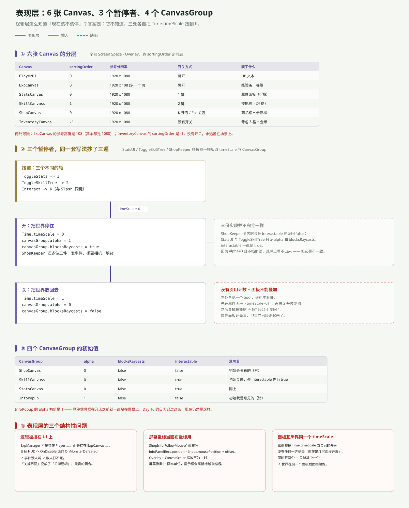

---
title: ARPG 模块专文（五）：表现层——六张 Canvas 与三个暂停者
date: 2026-11-05 23:00:00
tags: Unity, ARPG, 游戏开发, UI, Canvas, 时间缩放
summary: 表现层是 6 张 Screen Space - Overlay 的 Canvas、4 个 CanvasGroup、3 个「暂停者」。它们之间没有统一的面板管理器，属性面板 / 技能树 / 商店各自把 Time.timeScale 按到 0，各记一个 bool，谁也不看谁。同时记下三个结构性问题：ExpManager 挂在 ExpCanvas 上（关 HUD 就断链）、ShopInfo 把屏幕坐标当画布坐标用、面板互斥没有引用计数；另有两处配置遗留：ExpCanvas 参考高度 108、InfoPopup 初始 alpha 为 1。
cover: images/arpg-mod-c5.svg
pinned: false
draft: false
slug: arpg-module-ui
---

## 一句话说清

表现层是整个工程里**唯一没有「模块」的地方**：6 张 Canvas 并列、3 个暂停者各自为政、4 个 CanvasGroup 各管各的可见性。

它不参与战斗、不改数据，但它决定了三件很要命的事：**谁画在前面、什么时候整个世界停住、以及逻辑脚本会不会因为 UI 被关掉而失效。**

---

## 六张 Canvas，靠 sortingOrder 排队



全部是 `Screen Space - Overlay`（`renderMode = 0`），所以谁在前谁在后只看 `sortingOrder`：

| Canvas | sortingOrder | 参考分辨率 | 装了什么 |
|---|---|---|---|
| `InventoryCanvas` | −1 | 1920×1080 | 背包 3 格 + 金币 |
| `PlayerUI` | 0 | 1920×1080 | HP 文本 |
| `ExpCanvas` | 0 | **1920×108** | 经验条 + 等级 |
| `StatsCanvas` | 0 | 1920×1080 | 属性面板（8 格） |
| `ShopCanvas` | 0 | 1920×1080 | 商品格 + 悬停框 |
| `SkillCanvass` | 1 | 1920×1080 | 技能树（24 格） |

`InventoryCanvas` 用了 −1，意思是「永远在最底下、永远存在」——这也是它没有开关的直接原因。

`ExpCanvas` 的参考高度是 **108**，其余五张都是 1080。这是 Day 7 就记过的「少打一个 0」，现在仍然没改。今天没有可见后果，因为所有 CanvasScaler 的 `matchWidthOrHeight` 都是 0（按宽度匹配），高度值压根不参与计算——但哪天有人把一张改成按高度匹配，就会放大十倍。

---

## 三个暂停者：同一套模板抄了三遍

属性面板、技能树、商店都要「暂停世界」，三处实现几乎一模一样：

```csharp
// StatsUI
if (Input.GetButtonDown("ToggleStats"))
{
    if (statsOpen) { Time.timeScale = 1; statsCanvas.alpha = 0; statsCanvas.blocksRaycasts = false; statsOpen = false; }
    else           { Time.timeScale = 0; statsCanvas.alpha = 1; statsCanvas.blocksRaycasts = true;  statsOpen = true;  }
}
```

`ToggleSkillTree` 和 `ShopKeeper` 里是同一段代码，只有轴名和 CanvasGroup 引用不同。

三者的差异只有一处：**`ShopKeeper` 关店时会把 `interactable` 也设回 `false`，另外两个只设 `alpha` 和 `blocksRaycasts`。** 因为 `alpha = 0` 且不挡射线，观感上看不出区别——但这是个实打实的不一致。

---

## 面板不能叠加，因为没有人记账

三个暂停者各自只有一个 `bool`：

```csharp
private bool statsOpen = false;      // StatsUI
private bool skillTreeOpen = false;  // ToggleSkillTree
private bool isShopOpen;             // ShopKeeper
```

没有一处知道「现在有几层面板开着」。于是：

1. 按 `1` 开属性面板 → `timeScale = 0`
2. 按 `2` 开技能树 → `timeScale` 仍是 0（看起来正常）
3. 关掉技能树 → `timeScale = 1`

**结果：属性面板还亮着，但世界已经跑起来了。** 怪物继续走、继续打人，而玩家在看属性。

正确的写法是一个 `PanelStack`（或引用计数）：谁开谁 push，关的时候 pop，只有栈空了才把 `timeScale` 放回 1。

---

## 四个 CanvasGroup 的初始值

| CanvasGroup | alpha | blocksRaycasts | interactable | 意味着 |
|---|---|---|---|---|
| `ShopCanvas` | 0 | false | false | 初始关着（正确） |
| `SkillCanvass` | 0 | false | **true** | 关着，但 `interactable` 没关 |
| `StatsCanvas` | 0 | false | **true** | 同上 |
| `InfoPopup` | **1** | false | false | 初始就是可见的（错） |

`InfoPopup` 的 `alpha = 1` 意味着：**开店之前，那个商品信息框就一直贴在屏幕上。** 这是 Day 16 记过的坑，现在仍然是这样——`ShopInfo.HideItemInfo()` 只在鼠标移出商品格时才会被调用，没人负责初始化。

---

## 三个结构性问题

### ① 逻辑被挂在 UI 上

`ExpManager` 不是挂在 `Player` 上，也不是挂在一个空的 `GameManager` 上，而是挂在 `ExpCanvas` 这个 UI 物体上。

它的订阅写在 `OnEnable` / `OnDisable`：

```csharp
private void OnEnable()  { Enemy_Health.OnMonsterDefeated += GainExperience; }
private void OnDisable() { Enemy_Health.OnMonsterDefeated -= GainExperience; }
```

于是：**关掉 HUD → 退订 → 事件没人听 → 敌人打不死。**

这不是边缘情况。`ExpCanvas.SetActive(false)` 是很正常的操作（截图、过场、看剧情），而它的后果是「怪物血量归零但还站着追你」。

**把逻辑脚本挂在 UI 物体上，等于把逻辑的生命周期交给了 UI 的显隐。**

### ② 屏幕坐标当画布坐标用

`ShopInfo` 让信息框跟着鼠标走：

```csharp
public void FollowMouse()
{
    Vector3 mousePosition = Input.mousePosition;
    Vector3 offset = new Vector3(10, -10, 0);
    infoPanelRect.position = mousePosition + offset;
}
```

`Input.mousePosition` 是**屏幕像素**，而 `RectTransform.position` 是**画布单位**。当 CanvasScaler 的缩放因子不等于 1（参考 1920×1080，实际 1280×720 时 scaleFactor = 0.667），两者就不在同一个坐标系里。

结果：提示框会离鼠标越来越远，分辨率越低偏得越多。正确做法是 `RectTransformUtility.ScreenPointToLocalPointInRectangle`。

### ③ 面板互斥靠同一个 timeScale

见上一节的例子。三处共用 `Time.timeScale` 这一个全局变量，却各记各的 bool，没有仲裁者。

---

## 还有两个「看起来能用」的细节

**属性面板只填了 2 个格子。** `StatsUI.statsSlots` 有 8 个元素，但 `UpdateDamage()` 只写 `[0]`、`UpdateSpeed()` 只写 `[1]`，剩下 6 格永远是占位文本。

**`ToggleSkillTree.statsCanvas` 名不副实。** 字段名叫 `statsCanvas`，实际指的是技能树的 `CanvasGroup`。从 `StatsUI` 那边复制过来忘了改名——和 Day 6 的 `StatsManger` 拼写错误是同一类问题。

---

## 表现层的接口清单

| 方向 | 接口 | 形态 |
|---|---|---|
| 入（数据 → UI） | `StatsUI.UpdateAllStats()` | 被动调用（只在 Start 与 UpdateSpeed 里调） |
| 入（事件 → UI） | `ExpManager.UpdateUI()` | 自己刷自己 |
| 入（输入 → UI） | `GetButtonDown("ToggleStats"/"ToggleSkillTree"/"Interact")` | 轮询 |
| 出（UI → 全局） | `Time.timeScale = 0 / 1` | 全局副作用 |
| 出（UI → 逻辑） | 游戏物体 `SetActive(false)` | 隐式：**会连带停掉挂在它上面的脚本** |

最后一行是整个表现层最危险的地方：**`SetActive` 在 Unity 里不只是「隐藏」，它会触发 `OnDisable`、会停掉协程、会让事件订阅消失。** 而 UI 的显隐是最容易被随手改的东西。

---

## 一句话总结

表现层真正的问题不是「画得怎么样」，而是三件事被混在了一起：**显隐、暂停、事件订阅**。三者都挂在 `SetActive` / `timeScale` 这两个全局开关上，而没有任何一层负责仲裁。

想让它稳下来，只需要两个小类：一个 `PanelManager`（管栈和 `timeScale`），一个挂逻辑的 `GameManager` 空物体（把 `ExpManager` 从 `ExpCanvas` 上搬下来）。

下一篇：[关卡与相机](/post/arpg-module-world.html)。
