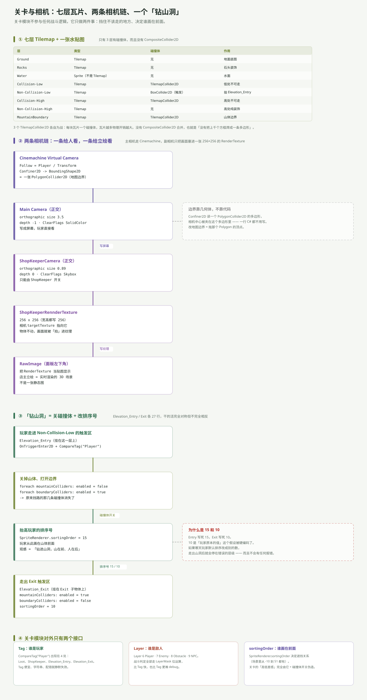

---
title: ARPG 模块专文（六）：关卡与相机——七层瓦片与两条相机链
date: 2026-11-05 23:30:00
tags: Unity, ARPG, 游戏开发, Tilemap, 相机, Cinemachine, 渲染排序
summary: 关卡模块不参与任何战斗，它只做两件事：挡住不该走的地方、决定谁画在前面。七层 Tilemap 里只有 3 层有碰撞体且没有 CompositeCollider2D；相机有两条链，Cinemachine 跟玩家、ShopKeeperCamera 只把画面拍进 256×256 的 RenderTexture；「钻山洞」靠关碰撞体 + 改 sortingOrder 15/10 伪造出高低差。最后把 Tag / Layer / sortingOrder 三个「静默失效」的机制摆在一起对照。
cover: images/arpg-mod-c6.svg
pinned: false
draft: false
slug: arpg-module-world
---

## 一句话说清

关卡模块是整个工程里**唯一和战斗完全无关**的部分。它不做判定、不改数值，只做两件事：

1. **挡住不该走的地方**（碰撞体）
2. **决定谁画在前面**（sortingOrder）

「高低差」这个听起来很高级的效果，就是用这两件事伪造出来的——**没有任何真正的 3D 或深度计算**。

---

## 七层瓦片，只有三层有碰撞



`Elevation_Base` 这个空物体下挂着一个 Grid 和 7 个 Tilemap：

| 层 | 类型 | 碰撞体 | 作用 |
|---|---|---|---|
| `Ground` | Tilemap | — | 地面底图 |
| `Rocks` | Tilemap | — | 石头装饰 |
| `Water` | **Sprite** | — | 水面 |
| `Collision-Low` | Tilemap | TilemapCollider2D | 低处不可走 |
| `Non-Collision-Low` | Tilemap | BoxCollider2D（触发） | 挂 `Elevation_Entry` |
| `Collision-High` | Tilemap | TilemapCollider2D | 高处不可走 |
| `Non-Collision-High` | Tilemap | — | 高处纯装饰 |
| `MountainBoundary` | Tilemap | TilemapCollider2D | 山体边界 |

两个容易忽略的点：

**`Water` 不是 Tilemap**，它只是一张 `SpriteRenderer`。所以水面没有瓦片级碰撞，靠别的层挡住。

**只有 3 个 `TilemapCollider2D`，而且没有 `CompositeCollider2D`。** 意思是每块瓦片各生成一个方框碰撞体，而不是把它们焊成一条多边形。瓦片越多，物理体越多——这是小地图无所谓、大地图会疼的选择。

---

## 相机有两条链，服务两个目的

### 链 A：给玩家看的

```
Cinemachine Virtual Camera（Follow = Player）
  → Confiner2D（BoundingShape2D = 一张 PolygonCollider2D）
  → Main Camera（正交，size 3.5，depth −1，ClearFlags = SolidColor）
  → 屏幕
```

边界限制这一块值得单独说：**`Confiner2D` 读的是一个 `PolygonCollider2D` 的多边形顶点**，相机中心被夹在这个多边形里。一行 C# 都不用写，改地图边界就是拖那个 Polygon 的顶点。

这是整个工程里「配置代替代码」做得最好的一处。

### 链 B：只给立绘看的

```
ShopKeeperCamera（正交，size 0.89，depth 0，ClearFlags = Skybox）
  → targetTexture = ShopKeeperRennderTexture（256 × 256）
  → RawImage（面板左下角）
```

店主立绘**不是一张贴图，是实时渲染的 3D 画面**：开店时把副相机挪到店主位置并 `SetActive(true)`，它渲染的东西被写进那张 256×256 的 RenderTexture，再由面板里的 `RawImage` 显示出来。

所以「店主」永远不会出现在主画面里（因为它只往 RT 写），但它会跟着场景实时变化——换皮肤、加动画，立绘立刻跟着变。

`depth` 的用法也值得记一笔：主相机 −1、副相机 0，看起来副相机在后，但因为副相机渲染到纹理而不是屏幕，实际不参与主画面的叠加顺序。

---

## 「钻山洞」：关碰撞 + 改排序号

这是关卡模块唯一的逻辑，两个脚本各 27 行，完全对称：

```csharp
// Elevation_Entry：走进 Non-Collision-Low 的触发区
foreach (var mountain in mountainColliders)  mountain.enabled = false;
foreach (var boundary in boundaryColliders)  boundary.enabled = true;
collision.gameObject.GetComponent<SpriteRenderer>().sortingOrder = 15;

// Elevation_Exit：走出 Exit 子物体的触发区
foreach (var mountain in mountainColliders)  mountain.enabled = true;
foreach (var boundary in boundaryColliders)  boundary.enabled = false;
collision.gameObject.GetComponent<SpriteRenderer>().sortingOrder = 10;
```

三步合起来产生的观感：

1. 原来挡路的山体碰撞体被关掉 → 玩家能走进去
2. 另一组边界碰撞体被打开 → 走不出山洞范围
3. 玩家排序号抬到 15 → 从此画在山体**前面**

「山在前、人在后」这件事，本质就是**同一个 Sprite 的 sortingOrder 变了**。

### 15 和 10 都是写死的

`Entry` 写死 15，`Exit` 写死 10。`10` 这个数字隐含了一个假设：**「玩家的默认 sortingOrder 就是 10」**。

如果哪天玩家默认排序改成别的值，走出山洞后就会停在错误的层级——不会报错，只会「莫名其妙钻到山后面去了」。

正确做法是在 `Entry` 里先记住原值（`originalOrder = sr.sortingOrder`），`Exit` 时还原。

---

## Tag / Layer / sortingOrder：三个「静默失效」的机制

关卡模块往外暴露的接口，全是这三样。它们的共同点是：**配错了不会报错，只会「不生效」。**

| 机制 | 用在哪 | 错的后果 |
|---|---|---|
| `CompareTag("Player")` | `Loot`、`ShopKeeper`、`Elevation_Entry`、`Elevation_Exit` | Tag 拼错 → 触发器完全不响应 |
| `LayerMask` 位运算 | 所有战斗判定（`OverlapCircleAll`、`Arrow` 碰撞） | 层配错 → 打不中、箭穿过去 |
| `sortingOrder` | 玩家 / 瓦片 / 所有 Sprite | 数字错 → 人钻到山里、道具看不见 |

层与 Tag 的实际配置：

- **Tag**：`Player`、`NPC`（只有两个自定义 Tag）
- **Layer**：6 `Player`、7 `Enemy`、8 `Obstacle`、9 `NPC`

分工很明确：**Tag 用来「这是谁」，Layer 用来「撞不撞、打不打」。** 战斗走 Layer（快、可位运算），交互走 Tag（简单、可读）。

---

## 关卡模块与其它模块的接缝

| 方向 | 接口 | 形态 |
|---|---|---|
| 出（关卡 → 玩家） | `SpriteRenderer.sortingOrder = 15 / 10` | 直接改组件 |
| 出（关卡 → 碰撞） | `Collider2D.enabled = true / false` | 直接改组件 |
| 入（世界 → 关卡） | `OnTriggerEnter2D + CompareTag("Player")` | 触发器回调 |
| 旁（相机 → 表现层） | `RenderTexture` → `RawImage` | 资产引用 |

**关卡模块是全场依赖最少的模块**：它只抓玩家的 `SpriteRenderer` 和一组 `Collider2D`，不认识 `StatsManger`、不认识任何事件，也不参与战斗。

---

## 一句话总结

关卡的「技术含量」集中在两个伪造上：**用碰撞体开关伪造「能进去」，用 sortingOrder 伪造「在里面」**。相机那边则用 Cinemachine 的 Confiner 省掉了一整套边界代码。

真正欠的是三处硬编码：`sortingOrder` 的 15 / 10、`ExpCanvas` 的参考高度 108、以及「玩家默认排序就是 10」这个从未被写下来的假设。

回到总览：[7 个模块的全景与五类接线](/post/arpg-modules-overview.html)。
